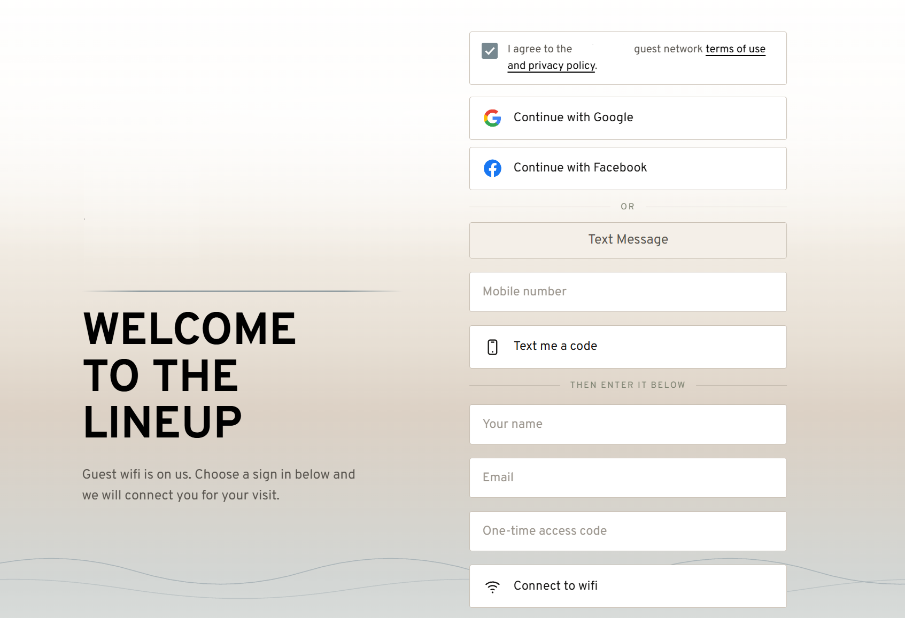

I designed and deployed a guest WiFi captive portal for a client, Google and Facebook sign-in, SMS verification, a custom splash page, built on IronWifi as the cloud captive portal and RADIUS backend, sitting in front of Ruckus One cloud-managed access points. It worked in testing. Then it started failing for real guests in a way that took two weeks to actually understand.

## The setup

The flow is standard for this kind of deployment: a guest associates to the open SSID, Ruckus redirects them to the portal instead of the internet, and the guest signs in with Google, Facebook, or a phone number and SMS code. Once verified, IronWifi sends a RADIUS attribute back that drops the device into a verified-guest role on the network, and Ruckus releases the connection.

Ruckus and IronWifi hand a client identifier back and forth to agree on who's being authorized: Ruckus tells IronWifi which MAC and IP are trying to connect, and IronWifi tells Ruckus which MAC and IP to let through. That handoff turned out to be exactly where things were breaking.

## The symptoms

Three things were happening, and none of them pointed at the same cause:

- **SMS sign-in failed with "you have requested too many SMS codes recently,"** even for a phone number that had never requested a code before. That reads like a rate limit, so the first instinct is to check rate limits. They were fine.
- **Google and Facebook sign-in would show a success page and then never actually release the device onto the network.** The portal thought the guest was authorized. The access point didn't agree.
- None of it was consistent. Some devices worked, some didn't, with no obvious pattern by browser, OS, or sign-in method.

## Ruling things out

I went through the usual suspects first, because the usual suspects are usually right: the walled garden (the list of domains a guest can reach before authenticating, needed for the SMS and OAuth providers to load at all), the SMS rate limits themselves, a possible IP block, the in-app popup browser the captive portal opens inside of, and the splash page's own JavaScript. All of it checked out. The portal's own logs showed successful authentications for the exact sessions that were stuck, which meant the problem wasn't in the portal's sign-in logic at all. It was in what happened after.

The thing that actually cracked it was adding a diagnostic line to the splash page itself: just printing the MAC and IP that Ruckus was handing to the portal, `mac ${client_mac} · ip ${ip_address}`, directly on the page during testing. The value on screen wasn't a MAC address. It was a scrambled, prefixed string, `ENC...` instead of a normal MAC.

## What was actually happening

Ruckus One has a guest-network option called "Enable the encryption for users' MAC and IP addresses," a privacy feature that encrypts the client identifier before handing it to the portal. IronWifi, independently, already does its own handling of that identifier for session tracking and the RADIUS handoff.

With both active, the identifier Ruckus sent didn't match what IronWifi expected, because each side was transforming the value and neither knew the other was doing it too. That explained the "too many SMS codes" error too: IronWifi was seeing what looked like the same scrambled identifier repeating across requests that should have been from different, brand-new phones, and its rate limiter treated them as one client hammering the endpoint.

The test that confirmed it: the exact same phone and browser worked fine when I typed the portal URL in directly, and failed when it arrived through Ruckus's redirect, which is the only path that carries the encrypted identifier. Same client, same page, different outcome, depending entirely on which route handed off the identifier.

## The fix

Turning off MAC/IP encryption on the Ruckus side fixed sign-in across every method, SMS, Google, and Facebook, in one change. IronWifi was already handling that identifier correctly on its own; Ruckus encrypting it a second time was the entire problem, not a contributing factor.

## Other things worth knowing from this build

A few smaller lessons came out of the same project, each one the kind of thing that costs an afternoon if you hit it cold:

- **Captive-portal popup browsers are their own environment.** Email verification links don't work reliably inside them, because the link opens in the device's full browser instead, which doesn't share a session with the popup. If a sign-in method depends on a link click completing inside the same session, it needs to not be a popup-dependent flow.
- **Hidden form validation can silently block submission with no visible error** inside a captive-portal popup. A `required` attribute or a `type="email"` input that fails native validation just does nothing, no red text, no shake, nothing, which makes it look like the backend is broken when it's actually the browser refusing to submit.
- **Field placement matters when a provider's own script reloads the page mid-flow.** IronWifi's "text me a code" step submits a real form and the page comes back fresh. Any fields positioned before that reload point get wiped. Moving name and email down next to the code-entry field, after the reload, was the fix, not a JavaScript patch.

None of these are exotic. They're the ordinary cost of wiring two independent systems together and asking them to agree on identity in real time, and the two-week version of this bug only makes sense once you realize that's what was actually happening: not one broken thing, but two correct things that disagreed.
