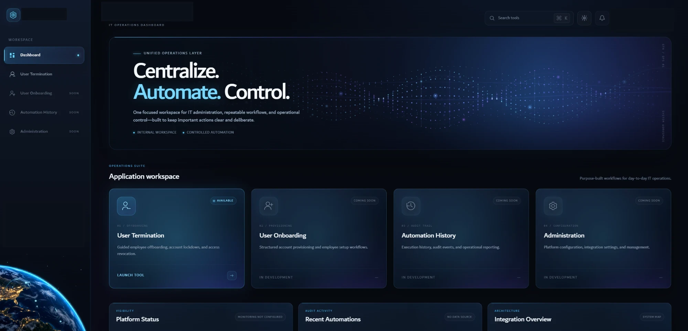

Offboarding an employee at a typical small business touches five or six disconnected systems: the directory, email, a password manager, a phone system, a handful of shared drives. Every one of those is a place access can quietly survive after someone's last day. I built an internal automation platform to close that gap, working alongside Codex as a pair-programming partner through implementation and a dedicated security review pass. The interesting part of the project was not the integrations themselves. It was making destructive, irreversible automation safe enough to actually run.

## The problem

Manual offboarding does not scale and does not stay consistent. Different technicians disable accounts in a different order, forget a step under time pressure, or skip verification because the directory already "looks right." The failure mode is not dramatic, it is a forgotten shared-mailbox permission or a stale vault entry that nobody notices for months.

The fix sounds simple: automate it. The hard part is that offboarding automation is inherently destructive. A bug does not throw an error, it disables the wrong account, deletes the wrong data, or silently does nothing while reporting success. That changes the entire engineering bar.

## Architecture

The platform is a Python backend (FastAPI) behind a reverse proxy, backed by a small relational database for job state and audit history, talking to:

- **The on-prem directory**, through an RMM platform's remote script execution, for account disablement, password reset, group cleanup, and moving the account to a quarantine OU.
- **Microsoft 365 / Entra ID**, through certificate-based Graph API access, for session revocation, account-state verification, cloud group cleanup, and license removal.
- **Exchange Online**, for converting the departing employee's mailbox to shared, setting up delegate access and forwarding so nothing gets lost, and removing their access from every other mailbox they had permissions on.
- **A password manager**, for locking the departing employee's vault and transferring ownership of their stored credentials to a successor.

A lightweight internal web frontend handles directory search/autocomplete, lets an operator review the exact identity being acted on before submitting, and tracks execution status.

## Making destructive automation safe

Three design decisions did most of the work here.

**Atomic job claims.** A termination request moves through `pending`, `running`, and a terminal state. The transition from pending to running is a single atomic database operation; a second concurrent attempt to claim the same job gets rejected outright instead of racing. Without this, a double-click or a retried request could trigger the same account lockdown twice, possibly against different systems mid-flight.

**Immutable identity snapshots.** When a request is created, the platform captures a complete snapshot of the identity it will act on, directory ID, account name, security identifier, group memberships, at that exact moment. Every later step verifies against that frozen snapshot rather than re-looking up the account. If the directory changes between request creation and execution, the platform does not silently follow the new data. It is intentionally stubborn about acting only on the identity it was told to act on.

**Fail closed, not open.** Every step validates its precondition before doing anything irreversible, and if a dependency fails, dependent later steps are recorded as skipped rather than attempted. A partially failed termination never retries blindly, because a retry after partial success is exactly how you get duplicate destructive actions.

The execution order itself is also a safety decision: lock out access immediately, preserve the departing employee's own mailbox before touching anything else (so legitimate business continuity isn't collateral damage), clean up their access elsewhere, and remove licenses last, since license removal is the one step that is genuinely hard to undo cleanly.

## What a security review turned up

Once the core pipeline worked end to end, I ran a focused, Codex-assisted security review against my own code rather than assuming "it works" meant "it's safe." That review found real issues worth fixing before anything destructive ran against production:

- No route-level authorization on the admin API, meaning the endpoints themselves had no auth boundary yet, a config-status endpoint disclosed more than it should have.
- A frontend/backend mismatch where the UI implied a review-only action but submission actually triggered execution immediately.
- Non-atomic job-status transitions, which is the exact race condition the atomic-claim redesign above was built to close.
- Cached permission data keyed on display-name strings instead of stable object IDs, which breaks quietly the moment someone's display name changes.
- A delegate-permission workflow that removed and re-added access in two separate steps, with a failure window in between where access could be lost entirely.

None of these were exotic. They were the ordinary ways automation quietly becomes unsafe, and the review earned its keep by catching them before a live run.

## Testing and controlled validation

The backend regression suite grew alongside the platform and now sits well over a hundred tests covering execution ordering, idempotency, the atomic-claim behavior under concurrency, and authorization boundaries. Those tests run against mocked integrations.

For actual live validation, every end-to-end run went against one dedicated, disposable test identity, never real employee data, with the platform's production-execution flag left off everywhere except that one scoped identity. That let me prove the entire pipeline, directory lockdown, session revocation, mailbox handling, vault lock-and-transfer, against a real environment without any risk to a real account.

## Where it stands

The core pipeline (directory lockdown, Microsoft 365 cleanup, Exchange mailbox handling, password-manager termination) is implemented and live-validated against the test identity. Remaining work is the less glamorous but equally necessary part of shipping an internal tool: role-based access control on the frontend, a scheduled-execution dispatcher for future-dated terminations, a retained-file cleanup job, and a VoIP system integration to round out the last disconnected piece.

The lesson I keep coming back to from this project: for anything destructive, the interesting engineering problem usually is not the integration, it's proving to yourself that it fails safely when something goes wrong, because something always eventually does.
